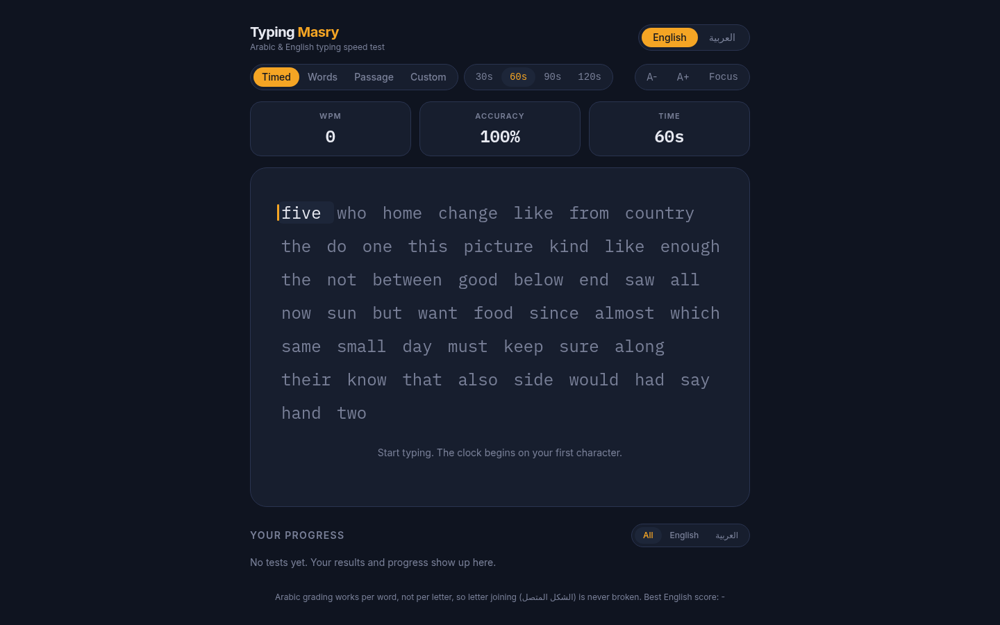

# Typing Masry

An Arabic and English typing speed test that treats Arabic as a first-class citizen: proper RTL layout, real Arabic passages, and grading that respects how Arabic letters join.

**Live demo:** https://malakmo7amed309.github.io/typing-masry/

## Standout feature

Most typing tests grade per character, which breaks Arabic completely - coloring letters one by one splits the text runs and destroys letter joining (the connected forms). Typing Masry grades Arabic **per word** instead: words never join across spaces, so shaping stays perfect, finished words turn green or red, and the current word gets a soft highlight with a blinking caret on the correct RTL side. English gets the same word-level flow.

## What else is in it

- Timed tests: 30 / 60 / 90 seconds, clock starts on your first keystroke
- Live WPM, accuracy and countdown
- Results screen with correct words and per-language best score
- Recent-tests history (last eight) saved in localStorage
- Four passages per language, cycled so you rarely repeat

## Stack

- React + Vite (single-file build)
- Tailwind CSS v4
- Noto Naskh Arabic + IBM Plex Mono

## Run it locally

```bash
npm install
npm run dev
```

`npm run build` produces the single-file build in `dist/`, which is what `docs/` serves through GitHub Pages.

## Screenshot


