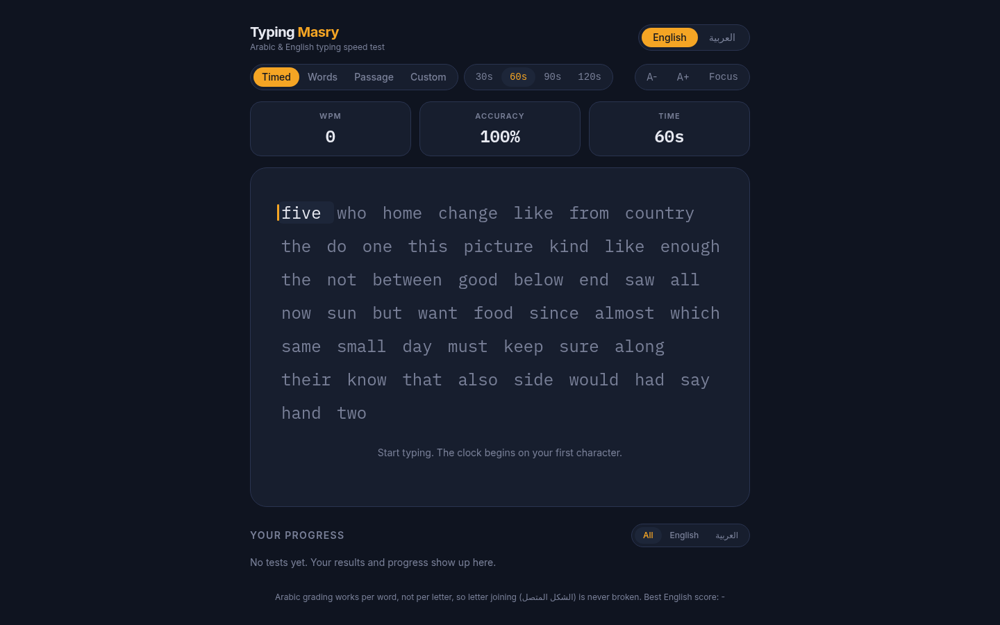
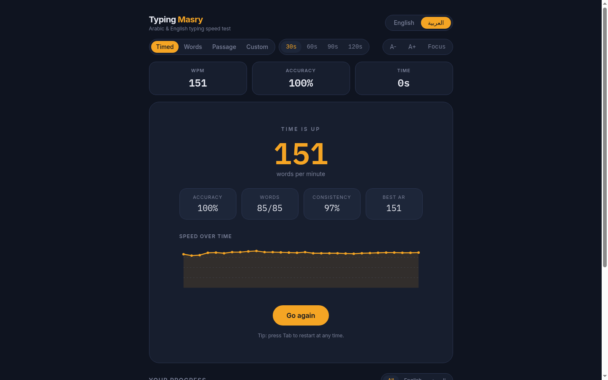
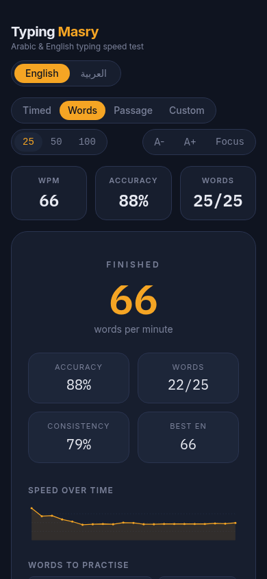

# Typing Masry

An Arabic and English typing speed test that treats Arabic as a first-class citizen: proper RTL layout, real Arabic passages, and grading that respects how Arabic letters join.

**Live demo:** https://malakmo7amed309.github.io/typing-masry/

## Standout feature

Most typing tests grade per character, which breaks Arabic completely - coloring letters one by one splits the text runs and destroys letter joining (the connected forms). Typing Masry grades Arabic **per word** instead: words never join across spaces, so shaping stays perfect, finished words turn green or red, and the current word gets a soft highlight with a blinking caret on the correct RTL side. English gets the same word-level flow.

## What else is in it

- Four modes: **Timed** (30/60/90/120 seconds, the text never runs out), **Words** (25/50/100), **Passage** (a full real passage) and **Custom** (paste your own text)
- Live WPM, accuracy and countdown. A **Focus** switch hides the numbers while you type
- Results: WPM, accuracy, consistency, a speed-over-time chart, and the words you got wrong with what you typed
- Progress panel: your tests, average and best WPM, a trend chart, filter by language, clear history. Everything stays in your browser (localStorage)
- Personal best per language, with a "new personal best" badge
- Text size buttons, Tab to restart, labelled controls for screen readers
- About 150 common words per language for endless tests, plus four passages each

## Stack

- React + Vite (single-file build)
- Tailwind CSS v4
- Noto Naskh Arabic + IBM Plex Mono

## Run it locally

```bash
npm install
npm run dev
```

`npm test` runs the unit tests for the scoring functions (WPM, accuracy, consistency, summaries). `npm run build` produces the single-file build in `dist/`, which is what `docs/` serves through GitHub Pages.

## Screenshots






